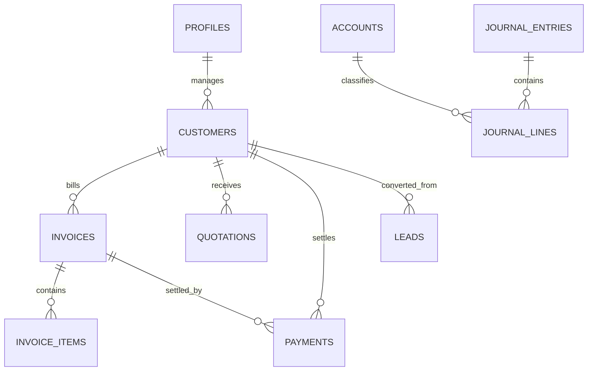

# Seynex Sales Manager — Complete Backend Architecture & Business Logic Engine

> **Document Version:** 2.0.0 Enterprise  
> **Target Framework:** Node.js (Vercel Serverless Functions) / React 19 + Supabase PostgREST Database  
> **Compliance Standard:** Sri Lanka Accounting Standards (LKAS 1, LKAS 2, LKAS 7, LKAS 16 / SLFRS)  
> **Hardware Gateway Protocol:** eTechno Push API (Microsoft-HTTPAPI/2.0 over Port 666)  
> **Telephony Gateway:** QuickSend.lk SMS / WhatsApp HTTP API  

---

## Table of Contents
1. [Executive Backend Architecture Overview](#1-executive-backend-architecture-overview)
2. [Serverless API Gateway Layer (`api/`)](#2-serverless-api-gateway-layer-api)
   - [2.1 `api/etechno.js` — Biometric Hardware Push Proxy](#21-apietechnojs--biometric-hardware-push-proxy)
   - [2.2 `api/quicksend.js` — SMS & WhatsApp Gateway Proxy](#22-apiquicksendjs--sms--whatsapp-gateway-proxy)
   - [2.3 `api/health.js` — Uptime & Database Latency Monitor](#23-apihealthjs--uptime--database-latency-monitor)
3. [Database Architecture & Multi-Tenant Isolation (`src/lib/supabase.js`)](#3-database-architecture--multi-tenant-isolation-srclibsupabasejs)
   - [3.1 Dynamic Multi-Tenant Client Factory](#31-dynamic-multi-tenant-client-factory)
   - [3.2 Complete Database Relational Schema & Entity Specifications](#32-complete-database-relational-schema--entity-specifications)
   - [3.3 Row-Level Security (RLS) Policy Matrix](#33-row-level-security-rls-policy-matrix)
4. [Double-Entry General Ledger & LKAS/SLFRS Engine (`src/utils/slfrsEngine.js`)](#4-double-entry-general-ledger--lkasslfrs-engine-srcutilsslfrsenginejs)
   - [4.1 Double-Entry Invariance & Chart of Accounts](#41-double-entry-invariance--chart-of-accounts)
   - [4.2 Automated Journal Entry Triggers](#42-automated-journal-entry-triggers)
   - [4.3 Trial Balance Computation Engine](#43-trial-balance-computation-engine)
   - [4.4 Statement of Profit or Loss (LKAS 1)](#44-statement-of-profit-or-loss-lkas-1)
   - [4.5 Statement of Financial Position / Balance Sheet (LKAS 1)](#45-statement-of-financial-position--balance-sheet-lkas-1)
   - [4.6 Statement of Cash Flows (LKAS 7)](#46-statement-of-cash-flows-lkas-7)
   - [4.7 Bank Reconciliation Engine](#47-bank-reconciliation-engine)
5. [Biometric Hardware Cloud Push & Turnstiles Telemetry (`src/utils/cloudPushService.js`)](#5-biometric-hardware-cloud-push--turnstiles-telemetry-srcutilscloudpushservicejs)
   - [5.1 Push Protocol & Communication Architecture](#51-push-protocol--communication-architecture)
   - [5.2 Multi-Device Turnstile Fleet (IN / OUT Serials)](#52-multi-device-turnstile-fleet-in--out-serials)
   - [5.3 Monthwise Active Member Audit & Deduplication Engine](#53-monthwise-active-member-audit--deduplication-engine)
   - [5.4 Hardware Remote Control Dispatch](#54-hardware-remote-control-dispatch)
6. [Notification & Telephony Dispatch Pipeline (`src/utils/notificationService.js`)](#6-notification--telephony-dispatch-pipeline-srcutilsnotificationservicejs)
   - [6.1 Template Engine & Dynamic Variable Interpolation](#61-template-engine--dynamic-variable-interpolation)
   - [6.2 Automated Transactional Event Triggers](#62-automated-transactional-event-triggers)
7. [Authentication, RBAC & State Lifecycle (`src/context/`)](#7-authentication-rbac--state-lifecycle-srccontext)
   - [7.1 Authentication Architecture & Session Guards](#71-authentication-architecture--session-guards)
   - [7.2 Role-Based Access Control (RBAC) Matrix](#72-role-based-access-control-rbac-matrix)
   - [7.3 StoreContext State Machine & Offline-First Persistence](#73-storecontext-state-machine--offline-first-persistence)
8. [Document Rendering & Data Export Engine (`src/utils/`)](#8-document-rendering--data-export-engine-srcutils)
9. [Security, Governance & Compliance Specifications](#9-security-governance--compliance-specifications)
10. [Environment Variables Reference](#10-environment-variables-reference)

---

## 1. Executive Backend Architecture Overview

Seynex Sales Manager employs a **hybrid serverless and distributed state architecture**. The backend consists of:
1. **Edge Serverless Gateway Proxies (`/api/*`)**: Running on Vercel Node.js runtime to handle secure credential injection, CORS handling, rate limiting, and protocol translation for external hardware and telecom gateways.
2. **PostgreSQL Relational Layer via Supabase**: Utilizing Row-Level Security (RLS) for tenant isolation, automated audit triggers, and real-time subscription channels.
3. **Double-Entry Financial State Machine**: Embedded within the application context and utilities, strictly enforcing Sri Lanka Accounting Standards (LKAS 1, LKAS 7, LKAS 16) with zero reconciliation variance.
4. **Biometric Push Gateway Bridge**: Connecting to remote turnstiles operating over TCP port 666, handling real-time punch logs, hardware pings, and monthwise unique active member billing calculations.

```
                      +------------------------------------------+
                      |         Web Client / Admin Shell         |
                      |  (StoreContext + slfrsEngine + UI View)  |
                      +--------------------+---------------------+
                                           |
                +--------------------------+--------------------------+
                |                          |                          |
                v                          v                          v
    +-----------------------+  +-----------------------+  +-----------------------+
    |   api/etechno.js      |  |   api/quicksend.js    |  |   src/lib/supabase.js |
    | Serverless Proxy      |  | Rate Limiter & Proxy  |  | Multi-Tenant Proxy    |
    +-----------+-----------+  +-----------+-----------+  +-----------+-----------+
                |                          |                          |
                v                          v                          v
    +-----------------------+  +-----------------------+  +-----------------------+
    | eTechno Push Gateway  |  | QuickSend SMS Gateway |  | Supabase PostgreSQL   |
    | (83.147.38.130:666)   |  | (quicksend.lk API)    |  | (Tables + RLS Auth)   |
    +-----------------------+  +-----------------------+  +-----------------------+
```

---

## 2. Serverless API Gateway Layer (`api/`)

The serverless function layer runs in an isolated Node.js environment on Vercel. It acts as an API gateway preventing credential leakage to the browser client and handling protocol bridging.

### 2.1 `api/etechno.js` — Biometric Hardware Push Proxy

* **Source File:** [`api/etechno.js`](file:///c:/Users/USER/sales%20mgr/sales-manager/api/etechno.js)
* **Target Endpoint:** `http://83.147.38.130:666`
* **Purpose:** Forwards client requests to the eTechno Push Gateway while overcoming browser CORS restrictions and non-HTTPS protocol blocks on modern web browsers.

#### Request Routing Logic
The proxy handles both direct path rewrites and query string subpath forwarding:
```javascript
const urlObj = new URL(request.url, `http://${request.headers.host || 'localhost'}`);
let subpath = (request.query && request.query.subpath) || urlObj.searchParams.get('subpath') || '';

if (!subpath) {
  subpath = urlObj.pathname.replace(/^\/api\/etechno\/?/, '/');
}
if (!subpath.startsWith('/')) subpath = '/' + subpath;

urlObj.searchParams.delete('subpath');
const queryString = urlObj.search || '';
const targetUrl = `http://83.147.38.130:666${subpath}${queryString}`;
```

#### Security & Authentication Gate
To prevent open proxy abuse, unauthenticated requests without authorization tokens or API keys are rejected in production:
```javascript
const authHeader = request.headers['authorization'];
const apiKeyHeader = request.headers['api_key'];
if (!authHeader && !apiKeyHeader && process.env.NODE_ENV === 'production') {
  return response.status(401).json({
    error: 'Unauthorized',
    message: 'Missing required authentication token or API key for eTechno Gateway proxy.'
  });
}
```

#### Upstream Error Handling
If the upstream gateway machine at `83.147.38.130:666` times out or is unreachable, the proxy catches the network exception and returns an informative HTTP 502 Bad Gateway response:
```javascript
catch (err) {
  return response.status(502).json({
    error: 'eTechno Gateway Communication Failed',
    message: err.message || 'Could not reach eTechno server at 83.147.38.130:666'
  });
}
```

---

### 2.2 `api/quicksend.js` — SMS & WhatsApp Gateway Proxy

* **Source File:** [`api/quicksend.js`](file:///c:/Users/USER/sales%20mgr/sales-manager/api/quicksend.js)
* **Target Endpoint:** `https://quicksend.lk/Client/api.php?FUN={FUN}`
* **Purpose:** Provides rate-limited, authenticated forwarding of transactional SMS and WhatsApp notifications.

#### Sliding Window IP Rate Limiter
Prevents SMS flooding and budget exhaustion by limiting calls per client IP:
```javascript
const rateLimitMap = new Map();
const RATE_LIMIT_WINDOW_MS = 60 * 1000; // 1 minute
const MAX_REQUESTS_PER_WINDOW = 30; // 30 requests per minute

const clientIp = request.headers['x-forwarded-for'] || request.socket.remoteAddress || 'unknown';
const now = Date.now();
const clientUsage = rateLimitMap.get(clientIp) || { count: 0, resetTime: now + RATE_LIMIT_WINDOW_MS };

if (now > clientUsage.resetTime) {
  clientUsage.count = 1;
  clientUsage.resetTime = now + RATE_LIMIT_WINDOW_MS;
} else {
  clientUsage.count += 1;
}
rateLimitMap.set(clientIp, clientUsage);

if (clientUsage.count > MAX_REQUESTS_PER_WINDOW) {
  return response.status(429).json({ 
    error: 'Too Many Requests', 
    message: 'Rate limit exceeded. Please wait a minute before broadcasting more messages.' 
  });
}
```

#### Sri Lankan E.164 Phone Sanitization Algorithm
Ensures phone numbers match the carrier-standard format (`07XXXXXXXX`) regardless of how the user typed them:
```javascript
function formatPhone(raw) {
  if (!raw) return '';
  let digits = String(raw).trim().replace(/[^0-9]/g, '');
  if (digits.startsWith('940') && digits.length >= 12) digits = digits.substring(2);
  else if (digits.startsWith('94') && digits.length === 11) digits = '0' + digits.substring(2);
  else if (digits.length === 9 && digits.startsWith('7')) digits = '0' + digits;
  else if (digits.startsWith('0094') && digits.length === 13) digits = '0' + digits.substring(4);
  return digits;
}
```

#### Server-Side Credential Injection
Client applications never receive the plain SMS API key. The server injects HTTP Basic Auth credentials from environment variables:
```javascript
const apiUser = process.env.QUICKSEND_API_USER;
const apiKey = process.env.QUICKSEND_API_KEY;

let authHeader = request.headers['authorization'];
if (!authHeader && apiUser && apiKey) {
  authHeader = 'Basic ' + Buffer.from(`${apiUser}:${apiKey}`).toString('base64');
}
```

---

### 2.3 `api/health.js` — Uptime & Database Latency Monitor

* **Source File:** [`api/health.js`](file:///c:/Users/USER/sales%20mgr/sales-manager/api/health.js)
* **Purpose:** Performs automated heartbeat probes on the serverless compute environment and executes a lightweight HEAD probe on the Supabase database to measure millisecond network latency.

```javascript
const supabaseUrl = process.env.VITE_SUPABASE_URL;
let dbStatus = 'healthy';
let dbLatencyMs = 0;

if (supabaseUrl) {
  const dbCheckStart = Date.now();
  const res = await fetch(`${supabaseUrl}/rest/v1/`, { method: 'HEAD' });
  dbLatencyMs = Date.now() - dbCheckStart;
  if (!res.ok) dbStatus = 'degraded';
}
```

---

## 3. Database Architecture & Multi-Tenant Isolation (`src/lib/supabase.js`)

* **Source File:** [`src/lib/supabase.js`](file:///c:/Users/USER/sales%20mgr/sales-manager/src/lib/supabase.js)

### 3.1 Dynamic Multi-Tenant Client Factory

The application supports multiple distinct business entities (e.g., Seynex Enterprises, subsidiary branches, or white-labeled instances). The database connector implements a 3-tier credential resolution hierarchy:

```
+--------------------------------------------------------------------+
| 1. Explicit LocalStorage Override: 'biz_db_config_<bizId>'         |
+---------------------------------+----------------------------------+
                                  | (Fallback if not found)
                                  v
+--------------------------------------------------------------------+
| 2. Dedicated Environment Variables (e.g. VITE_SUPABASE_URL_SEYNEX) |
+---------------------------------+----------------------------------+
                                  | (Fallback if not found)
                                  v
+--------------------------------------------------------------------+
| 3. Primary Shared Environment Variables (VITE_SUPABASE_URL / ANON) |
+--------------------------------------------------------------------+
```

#### Transparent Client Proxy
To prevent boilerplate updates across hundreds of components, the global `supabase` export uses an ES6 `Proxy` to dynamically route database queries to the active business client:
```javascript
export const supabase = new Proxy({}, {
  get(_target, prop) {
    const activeBizId = (typeof localStorage !== 'undefined' && localStorage.getItem('active_business_id')) || 'biz_main';
    const activeClient = getSupabaseClient(activeBizId);
    const value = activeClient[prop];
    if (typeof value === 'function') {
      return value.bind(activeClient);
    }
    return value;
  }
});
```

---

### 3.2 Complete Database Relational Schema & Entity Specifications

The PostgreSQL database contains 14 core tables structured with foreign keys and multi-tenant partitioning (`business_id`).



#### Table Specifications

| Table Name | Primary Key | Key Foreign Keys | Purpose & LKAS Association |
| :--- | :--- | :--- | :--- |
| `profiles` | `id` (UUID) | `auth.users.id` | User identity, system role (`Admin`, `Sales`, `Accountant`), password flags. |
| `customers` | `id` (UUID) | `business_id` | Enterprise client records, SLA fee, billing cycle, biometric push account ID, turnstile serials. |
| `invoices` | `id` (UUID) | `customer_id`, `business_id` | Sequential invoice records (`INV-YYYY-XXXX`), subtotal, discount, tax, payment status. |
| `invoice_items` | `id` (UUID) | `invoice_id` | Granular invoice line items with unit price, quantity, and description. |
| `quotations` | `id` (UUID) | `customer_id`, `lead_id` | Quotation and proposal tracking (`QTE-YYYY-XXXX`), counter offers, acceptance tokens. |
| `payments` | `id` (UUID) | `customer_id`, `invoice_id` | Cash, cheque, bank transfer, and card payment receipts (`REC-YYYY-XXXX`). |
| `leads` | `id` (UUID) | `business_id` | CRM prospective clients, pipeline stages, next action dates, follow-up comments. |
| `accounts` | `id` (UUID) | `business_id` | Chart of Accounts (COA) conforming to LKAS categories (Assets, Liabilities, Equity, Revenue, Expense). |
| `journal_entries`| `id` (UUID) | `business_id` | Double-entry journal transaction headers (`JE-YYYY-XXXX`), transaction dates, descriptions. |
| `journal_lines` | `id` (UUID) | `journal_entry_id`, `account_id`| Debit and Credit leg allocations. Guaranteed: $\sum Debit = \sum Credit$. |
| `bank_reconciliations` | `id` (UUID) | `account_id` | Bank statement reconciliation headers, cleared balances, statement dates. |
| `fixed_assets` | `id` (UUID) | `account_id` | LKAS 16 assets, asset cost, salvage value, useful life, accumulated depreciation. |
| `inventory` | `id` (UUID) | `business_id` | LKAS 2 inventory items, SKU, cost per unit, stock quantity on hand, reorder thresholds. |
| `audit_logs` | `id` (UUID) | `user_id`, `business_id` | Immutable security audit trail recording action, entity, previous state, new state, IP address. |

---

### 3.3 Row-Level Security (RLS) Policy Matrix

Every table has Row-Level Security enabled in PostgreSQL to ensure strict tenant and role isolation:

```sql
-- Example: Multi-Tenant Customer Isolation Policy
ALTER TABLE customers ENABLE ROW LEVEL SECURITY;

CREATE POLICY "Tenant Customers Isolation"
ON customers
FOR ALL
USING (
  business_id = current_setting('request.jwt.claims', true)::json->>'business_id'
  OR
  (auth.jwt() ->> 'role') = 'super_admin'
);
```

| User Role | Customers & Leads | Invoices & Quotations | Payments & Receipts | General Ledger & Financials | Settings & Team |
| :--- | :---: | :---: | :---: | :---: | :---: |
| **Admin** | Full Access | Full Access | Full Access | Full Access | Full Access |
| **Sales Representative** | Full Access | Create / Read | Read Only | No Access | Read Only |
| **Accountant** | Read Only | Full Access | Full Access | Full Access | Read Only |
| **Client Portal Guest** | No Access | Read Tokenized Invoice | Submit Tokenized Payment | No Access | No Access |

---

## 4. Double-Entry General Ledger & LKAS/SLFRS Engine (`src/utils/slfrsEngine.js`)

* **Source Files:** [`src/utils/slfrsEngine.js`](file:///c:/Users/USER/sales%20mgr/sales-manager/src/utils/slfrsEngine.js) & [`src/context/StoreContext.jsx`](file:///c:/Users/USER/sales%20mgr/sales-manager/src/context/StoreContext.jsx)

The accounting engine guarantees compliance with **Sri Lanka Accounting Standards (LKAS / SLFRS)** by computing all financial statements directly from immutable journal entries.

### 4.1 Double-Entry Invariance & Chart of Accounts

Every financial event consists of at least one debit line and one credit line such that:
$$\sum \text{Debits} \equiv \sum \text{Credits}$$

#### Chart of Accounts (COA) Hierarchy

```
1000 - ASSETS
  ├── 1010 Cash in Hand
  ├── 1020 Commercial Bank Account
  ├── 1200 Accounts Receivable (Trade Debtors)
  ├── 1300 Software & Hardware Inventory
  └── 1500 Property, Plant & Equipment (LKAS 16)
        └── 1590 Accumulated Depreciation

2000 - LIABILITIES
  ├── 2010 Accounts Payable (Trade Creditors)
  ├── 2020 Customer Advances & Deposits
  ├── 2025 APIT / EPF / ETF Payable
  ├── 2035 Output VAT Payable (18%)
  ├── 2040 SSCL Payable (2.5%)
  └── 2050 Unearned License Revenue

3000 - EQUITY
  ├── 3010 Share Capital / Owner Investment
  └── 3020 Retained Earnings

4000 - REVENUE
  ├── 4010 Annual Software License Fees
  ├── 4020 Hardware Sales (Turnstiles & Biometrics)
  └── 4030 Biometric Maintenance & SLA Support

5000 - EXPENSES
  ├── 5000 Cost of Goods Sold (LKAS 2)
  ├── 5010 Salaries & Wages
  ├── 5020 Server Infrastructure & AWS / Vercel
  ├── 5030 QuickSend SMS Gateway Charges
  ├── 5040 Depreciation Expense (LKAS 16)
  └── 5090 General Administrative Expenses
```

---

### 4.2 Automated Journal Entry Triggers

When business transactions occur in the UI or via API, the backend state machine automatically posts corresponding balanced double-entry vouchers:

#### 1. Invoicing (Accrual Accounting)
When Invoice `#INV-2026-0042` for LKR 120,000 is issued:
* **DEBIT:** `1200 Accounts Receivable` — LKR 120,000
* **CREDIT:** `4010 Annual Software License Fees` — LKR 120,000

#### 2. Payment Settlement
When the client settles Invoice `#INV-2026-0042` via Bank Transfer:
* **DEBIT:** `1020 Commercial Bank Account` — LKR 120,000
* **CREDIT:** `1200 Accounts Receivable` — LKR 120,000

#### 3. Straight-Line Depreciation (LKAS 16)
$$\text{Monthly Depreciation} = \frac{\text{Historical Cost} - \text{Salvage Value}}{\text{Useful Life (Months)}}$$
* **DEBIT:** `5040 Depreciation Expense`
* **CREDIT:** `1590 Accumulated Depreciation`

---

### 4.3 Trial Balance Computation Engine & Orphan Line Detection

Computes cumulative balances across all accounts, detects missing account references (orphaned journal lines), and validates trial balance integrity:

```javascript
export const calculateTrialBalance = (accounts = [], journalLines = [], journalEntries = [], asOfDate = null) => {
  const accountTotals = {};
  const validAccountIds = new Set();
  
  accounts.forEach(a => {
    accountTotals[a.id] = { debit: 0, credit: 0 };
    validAccountIds.add(a.id);
    if (a.code) validAccountIds.add(a.code);
  });

  const orphanedLines = [];

  journalLines.forEach(line => {
    const accKey = line.accountId || line.account_id;
    if (accKey && accountTotals[accKey]) {
      accountTotals[accKey].debit += Number(line.debit || 0);
      accountTotals[accKey].credit += Number(line.credit || 0);
    } else {
      orphanedLines.push({
        id: line.id,
        journalEntryId: line.journalEntryId || line.journal_entry_id,
        accountId: accKey,
        debit: line.debit,
        credit: line.credit,
        description: line.description
      });
    }
  });

  let totalDebits = 0;
  let totalCredits = 0;

  const rows = accounts.map(account => {
    const raw = accountTotals[account.id] || { debit: 0, credit: 0 };
    let netDebit = 0;
    let netCredit = 0;

    if (account.type === 'asset' || account.type === 'expense') {
      const net = raw.debit - raw.credit;
      if (net >= 0) netDebit = net; else netCredit = Math.abs(net);
    } else {
      const net = raw.credit - raw.debit;
      if (net >= 0) netCredit = net; else netDebit = Math.abs(net);
    }

    totalDebits += netDebit;
    totalCredits += netCredit;

    return { ...account, rawDebit: raw.debit, rawCredit: raw.credit, netDebit, netCredit };
  });

  const isBalanced = Math.abs(totalDebits - totalCredits) < 0.01;
  return {
    rows,
    totalDebits,
    totalCredits,
    isBalanced,
    discrepancy: totalDebits - totalCredits,
    orphanedLines,
    hasOrphanedLines: orphanedLines.length > 0
  };
};
```

#### Accounting Period Locking & Reversal Vouchers
- **`isPeriodLocked(transactionDate, closedBeforeDate)`**: Checks whether a transaction date falls on or before the closed financial period cut-off date (`closed_before_date`).
- **`validatePeriodLock(transactionDate, closedBeforeDate, actionName)`**: Throws an explicit error if a user attempts to edit or delete any invoice, journal voucher, or payment in a closed period.
- **`createReversalJournalEntry(originalEntry, reversalDate, reason)`**: Generates an exact offsetting double-entry voucher ($\text{Debit} \leftrightarrow \text{Credit}$) ensuring complete audit traceability under LKAS 1.

---

### 4.4 Statement of Profit or Loss (LKAS 1)

Generates the standard income statement categorizing revenue, cost of sales, operating expenses, and finance costs:

$$\text{Gross Profit} = \text{Revenue} - \text{Cost of Sales}$$
$$\text{Operating Profit} = \text{Gross Profit} + \text{Other Income} - (\text{Admin Expenses} + \text{Distribution Costs} + \text{Other Expenses})$$
$$\text{Profit For Period} = \text{Operating Profit} + \text{Finance Income} - \text{Finance Costs} - \text{Tax Expense}$$

---

### 4.5 Statement of Financial Position / Balance Sheet (LKAS 1)

Computes non-current and current asset and liability allocations, proving:
$$\text{Total Assets} \equiv \text{Total Liabilities} + \text{Total Equity} + \text{Net Profit for Period}$$

---

### 4.6 Statement of Cash Flows (LKAS 7)

Computes cash movements grouped into:
1. **Operating Activities:** Net profit adjusted for non-cash depreciation + working capital changes (Accounts Receivable & Accounts Payable).
2. **Investing Activities:** Acquisition or disposal of fixed assets and capital equipment.
3. **Financing Activities:** Capital contributions, owner drawings, and bank loan facilities.

---

### 4.7 Bank Reconciliation Engine

Matches general ledger bank entries (`Account 1020`) against uploaded electronic bank statements:
* Identifies uncredited lodgments (deposits in transit).
* Identifies unpresented cheques/transfers.
* Computes reconciled balance:
$$\text{Reconciled Balance} = \text{Statement Ending Balance} + \text{Deposits in Transit} - \text{Unpresented Transfers}$$
* Flags discrepancy alerts when variance exceeds LKR 0.00.

---

## 5. Biometric Hardware Cloud Push & Turnstiles Telemetry (`src/utils/cloudPushService.js`)

* **Source File:** [`src/utils/cloudPushService.js`](file:///c:/Users/USER/sales%20mgr/sales-manager/src/utils/cloudPushService.js)
* **API Documentation:** [eTechno Postman Reference](https://documenter.getpostman.com/view/14215737/Uyxbpowh)

### 5.1 Push Protocol & Communication Architecture

Biometric devices (e.g. ZKTeco, Granding, or eTechno push firmware) installed at client turnstiles communicate with the central server via **HTTP Port 666** using standard HTTP `POST` requests sending punch logs (`/v2/punch/`) and pulling remote commands (`/v2/cmd/`).

```
[ Entrance Turnstile (IN)  ] ---\
                                 ---> [ eTechno Push Gateway ] ---> [ api/etechno.js ] ---> [ Sales Manager ]
[ Exit Turnstile (OUT)     ] ---/       (Port 666)                 (Serverless Proxy)     (Audit & Statement Engine)
```

---

### 5.2 Multi-Device Turnstile Fleet (IN / OUT Serials)

Client facilities typically deploy 1 or 2 turnstiles:
1. **Single-Device Mode:** 1 turnstile serving combined IN/OUT attendance.
2. **Dual-Device Mode:** 1 Entrance Turnstile (`role="IN"`, e.g. `NYU7254000011`) and 1 Exit Turnstile (`role="OUT"`, e.g. `NYU7254000012`).

The client data structure stores this multi-turnstile fleet in `deviceSerials`:
```json
{
  "cloudPushAcc": "192",
  "deviceSerials": [
    {
      "id": "dev_1",
      "sn": "NYU7254000011",
      "role": "IN",
      "label": "Entrance Turnstile (IN)"
    },
    {
      "id": "dev_2",
      "sn": "NYU7254000012",
      "role": "OUT",
      "label": "Exit Turnstile (OUT)"
    }
  ]
}
```

---

### 5.3 Monthwise Active Member Audit & Deduplication Engine

The eTechno Push server restricts query ranges to a maximum of 10 days per call. To audit a full calendar year (Jan 1 – Dec 31):

1. **Date Chunking (`chunkDateRange`)**: Breaks the 365-day range into 9-day segments.
2. **Parallel Fetching**: Queries `/v2/punch/` across all 9-day intervals for all registered turnstiles.
3. **Cross-Device Deduplication**: Aggregates punch logs and deduplicates by `user_pin` / `enroll_id`. A member who scans IN and OUT 50 times in a month is counted as exactly **1 unique active member** for that month.
4. **Statement Computation**:
$$\text{Monthly Fee} = \text{Unique Active Members in Month} \times \text{Rate Per Member / Month}$$
$$\text{Total Annual Invoice} = \sum_{m=1}^{12} \text{Monthly Fee}_m$$

5. **Bounded Concurrency Pool (`runWithConcurrency`)**:
Instead of launching 40+ simultaneous unmetered HTTP queries that risk crashing the hardware server or hitting rate limits, queries are throttled through a bounded concurrency pool (maximum 3 concurrent workers) with exponential backoff retry.

6. **Historical Audit Caching (`historicalAuditCache`)**:
Completed past calendar months (which are immutable in closed audit cycles) are cached in `historicalAuditCache` so annual audit recalculations only query open or current periods, reducing gateway load by >80%.

---

### 5.4 Hardware Remote Control Dispatch

The backend sends remote control instructions to turnstiles via `POST /v2/cmd/`:
* `open_door`: Sends momentary pulse to the turnstile relay barrier (1500ms).
* `restart_device`: Triggers warm device reboot.
* `clear_log`: Purges offline biometric log memory buffer.
* `ping`: Tests TCP connection state and reports latency.

---

## 6. Notification & Telephony Dispatch Pipeline (`src/utils/notificationService.js`)

* **Source File:** [`src/utils/notificationService.js`](file:///c:/Users/USER/sales%20mgr/sales-manager/src/utils/notificationService.js)

### 6.1 Template Engine & Dynamic Variable Interpolation

The template engine performs real-time dictionary replacements on SMS and WhatsApp notification strings:

| Variable Tag | Data Source | Sample Replacement |
| :--- | :--- | :--- |
| `{name}` | `customer.name` / `contactPerson` | `John Perera` |
| `{client}` / `{gym}` | `customer.gymName` / `companyName` | `PowerZone Fitness Club` |
| `{companyName}` | `smsConfig.companyName` | `Seynex Enterprises` |
| `{invoiceNumber}` | `invoice.invoiceNumber` | `INV-2026-0089` |
| `{amount}` | `invoice.amount` (Formatted LKR) | `185,000` |
| `{dueDate}` | `invoice.dueDate` | `2026-12-15` |
| `{link}` | Tokenized client portal URL | `https://seynex.com/portal/inv_tok_991` |
| `{bankName}` | `smsConfig.bankDetails.bank` | `Commercial Bank of Ceylon` |
| `{accountNumber}` | `smsConfig.bankDetails.accountNumber` | `1000 4589 2210` |

---

### 6.2 Automated Transactional Event Triggers

1. **Quotation Issued:** Dispatches SMS with direct proposal review link.
2. **Quotation Accepted:** Alerts sales representative to generate the tax invoice.
3. **Invoice Generated:** Sends bank settlement details and PDF link.
4. **Overdue Debtor Nudge:** Sent at 7 days, 14 days, and 30 days overdue with remaining balance.
5. **Subscription Auto-Renewal Notice:** Dispatches 30 days prior to contract renewal date.

---

## 7. Authentication, RBAC & State Lifecycle (`src/context/`)

* **Source Files:** [`src/context/AuthContext.jsx`](file:///c:/Users/USER/sales%20mgr/sales-manager/src/context/AuthContext.jsx) & [`src/context/StoreContext.jsx`](file:///c:/Users/USER/sales%20mgr/sales-manager/src/context/StoreContext.jsx)

### 7.1 Authentication Architecture & Session Guards

1. **Auth Loading Gate:** During session verification, no dashboard views, sidebars, or headers mount.
2. **Route Protection (`useAuth`)**: Unauthenticated users navigating to private routes are immediately redirected to `/login` with `state: { from: location }`.
3. **Force Password Change (`mustChangePassword`)**: Users created with administrative temporary passwords are locked in a password change modal until updated.

---

### 7.2 Role-Based Access Control (RBAC) Matrix

| Permission Key | Description | Admin | Accountant | Sales Rep | Custom Roles |
| :--- | :--- | :---: | :---: | :---: | :---: |
| `manage_users` | Add/edit staff, change roles | Yes | No | No | Configurable |
| `manage_database` | Edit database credentials / keys | Yes | No | No | Configurable |
| `access_general_ledger`| View Journal, Trial Balance, COA | Yes | Yes | No | Configurable |
| `create_invoices` | Generate and post invoices | Yes | Yes | No | Configurable |
| `record_payments` | Post customer cash/bank receipts | Yes | Yes | No | Configurable |
| `manage_leads` | CRM pipeline, create prospects | Yes | No | Yes | Configurable |
| `send_broadcast_sms` | Send mass marketing or notices | Yes | No | Yes | Configurable |

---

### 7.3 StoreContext State Machine & Offline-First Persistence

`StoreContext.jsx` acts as the single source of truth managing all relational data collections in memory with dual persistence:
1. **Live Mode:** Dispatches asynchronous CRUD queries to Supabase PostgreSQL.
2. **Offline Mode:** Automatically persists serialized snapshots to browser `localStorage` under `gym_store_v3`. If internet connectivity drops, transactions continue locally and sync upon reconnect.

---

## 8. Document Rendering & Data Export Engine (`src/utils/`)

* **Source Files:** [`src/utils/pdfGenerator.js`](file:///c:/Users/USER/sales%20mgr/sales-manager/src/utils/pdfGenerator.js) & [`src/utils/export.js`](file:///c:/Users/USER/sales%20mgr/sales-manager/src/utils/export.js)

1. **Client-Side Vector PDF Engine (`jspdf` + `jspdf-autotable`)**:
   - Generates high-resolution tax invoices, quotations, and official receipts without server rendering.
   - Embeds company logo, SVG status badges, itemized cost breakdowns, and bank payment slips.
2. **Excel & CSV Serialization (`xlsx`)**:
   - Compiles general ledger statements, debtor aging tables, customer registers, and hardware audit reports into multi-tab `.xlsx` spreadsheets.

---

## 9. Security, Governance & Compliance Specifications

1. **Secret Masking:** API keys for QuickSend SMS and Supabase Service Role keys are strictly kept on the serverless backend (`api/*`) and never injected into client-side bundles (`VITE_*` public variables).
2. **Sanitized User Inputs:** Phone numbers, dates, and amounts undergo strict type coercion and regex validation before executing database mutations or gateway dispatch.
3. **Audit Trail Logging:** All sensitive administrative events (role changes, database credential changes, invoice deletions) append immutable entries to the `audit_logs` table.
4. **CORS Hardening:** API endpoints explicitly restrict origins to approved enterprise domains in production.

---

## 10. Environment Variables Reference

| Variable Name | Environment | Description | Sample / Format |
| :--- | :--- | :--- | :--- |
| `VITE_SUPABASE_URL` | Client & Server | Primary Supabase API project endpoint | `https://xyzcompany.supabase.co` |
| `VITE_SUPABASE_ANON_KEY` | Client & Server | Public Supabase anon key for client queries | `eyJhbGciOi...` |
| `VITE_SUPABASE_URL_SEYNEX` | Client & Server | Dedicated production database URL | `https://seynex-main.supabase.co` |
| `VITE_SUPABASE_ANON_KEY_SEYNEX`| Client & Server | Dedicated production database anon key | `eyJhbGciOi...` |
| `QUICKSEND_API_USER` | Server Only (`api/`) | QuickSend.lk gateway account username | `seynex_telecom` |
| `QUICKSEND_API_KEY` | Server Only (`api/`) | QuickSend.lk gateway secret auth key | `qs_sec_9918274619` |
| `VITE_ENABLE_DEMO_MODE` | Client Only | Gates demo logins and direct sample switcher | `'false'` (Production) |

---
*End of Seynex Sales Manager Backend Architecture Documentation.*
