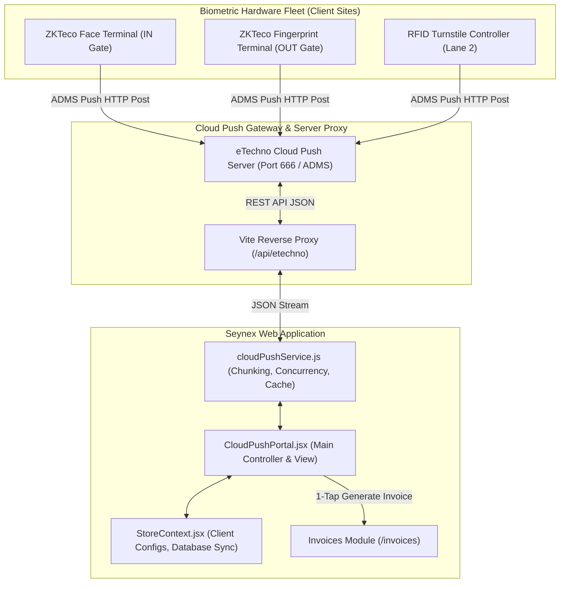
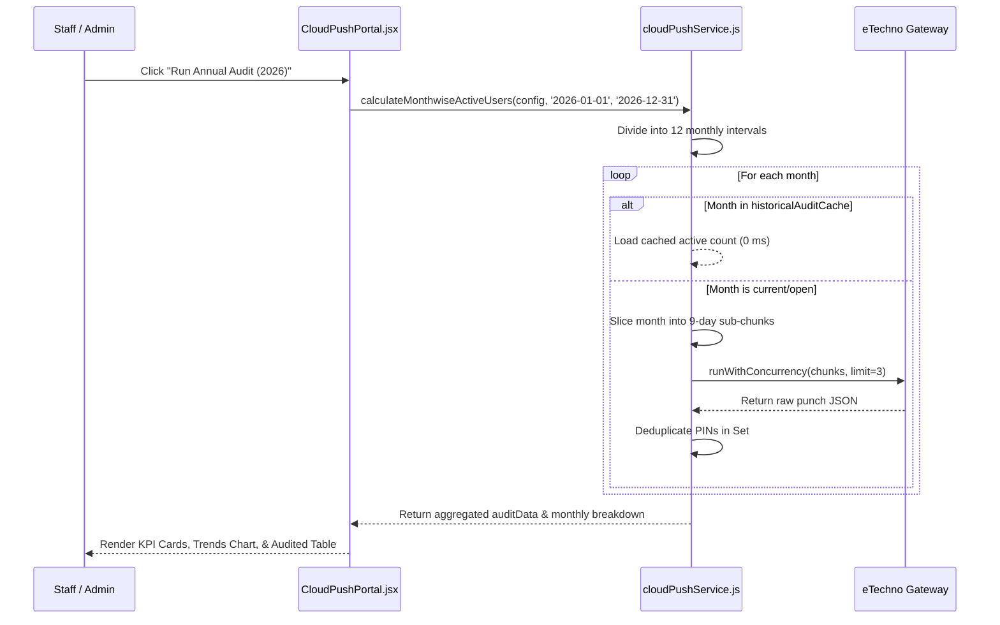

# Seynex Cloud Push Portal — Architecture, Logic, Layout & UI Specification

> **Module**: Cloud Push & Biometric IoT Hardware Integration  
> **Primary Components**: [`src/pages/CloudPushPortal.jsx`](file:///c:/Users/USER/sales%20mgr/sales-manager/src/pages/CloudPushPortal.jsx) & [`src/utils/cloudPushService.js`](file:///c:/Users/USER/sales%20mgr/sales-manager/src/utils/cloudPushService.js)  
> **Route**: `/cloud-push`  
> **Protocol**: ZKTeco ADMS / eTechno Cloud Push API (`http://83.147.38.130:666` & `/api/etechno`)  
> **Last Updated**: November 2026  

---

## 1. Executive Overview & System Architecture

The **Cloud Push Portal** is an enterprise-grade IoT hardware synchronization, attendance telemetry, and automated SaaS billing engine. It bridges Seynex Sales Manager with physical biometric access-control hardware (ZKTeco speed gates, turnstiles, face recognition terminals, and fingerprint scanners) deployed across fitness centers, corporate offices, and wholesale enterprise clients.



### Core Capabilities
1. **Automated Monthwise Active Member Audit**: Computes exact unique cardholders/users with at least 1 verified biometric punch per calendar month.
2. **SaaS Billing Engine**: Converts verified monthly active user counts into billable amounts based on custom tier rates (e.g., LKR 100/user/month), with 1-tap conversion to official Tax Invoices and PDF audit statements.
3. **Real-Time Punch Stream**: Live WebSocket-like polling feed monitoring access control logs, direction (`IN` vs `OUT`), user PINs, and authentication modes (Face, Fingerprint, RFID, Password).
4. **Hardware Remote Commands**: Over-the-air (OTA) execution of ADMS commands (Reboot, Sync Time, Clear Admin Lockout, Trigger Door Relay, Query Device Stats).
5. **Terminal Fleet Management**: Multi-device hardware configuration per client (turnstile pairs, lane assignment, hardware health checks, and instant ping tests).

---

## 2. Core Business Logics & Mathematical Algorithms

### 2.1 The Active Member Computation Algorithm
The system does not bill clients based on total registered members in the database; rather, it bills strictly based on **active hardware utilization**.

$$\text{Active Member Definition}: \quad \exists \, p \in \text{Punches} \quad \text{such that} \quad p.\text{PIN} = u \quad \text{and} \quad p.\text{timestamp} \in [\text{Month}_{\text{start}}, \text{Month}_{\text{end}}]$$

```javascript
// Unique Active User Set Computation (cloudPushService.js)
const activeUsersSet = new Set();
const userPunchFrequency = new Map();

for (const punch of rawMonthlyTransactions) {
  const pin = String(punch.PIN || punch.Pin || punch.EnrollNumber || '').trim();
  if (pin && pin !== '0') {
    activeUsersSet.add(pin);
    userPunchFrequency.set(pin, (userPunchFrequency.get(pin) || 0) + 1);
  }
}

const uniqueActiveCount = activeUsersSet.size;
const totalPunchesInMonth = rawMonthlyTransactions.length;
const monthlyBilledAmount = uniqueActiveCount * ratePerUserMonth;
```

### 2.2 Date Chunking & Concurrency Pipeline
The physical hardware gateway has an API constraint restricting date queries to a maximum of 9–10 days per HTTP request. To query an entire calendar year without timing out or overflowing the terminal:

1. **Interval Bucket Split**: `getMonthIntervals(startDate, endDate)` divides the range into discrete calendar months.
2. **Sub-Chunking**: `chunkDateRange(monthStart, monthEnd, 9)` slices each month into sub-periods of 9 days.
3. **Bounded Concurrency**: `runWithConcurrency(chunks, 3, asyncFn)` executes up to 3 parallel requests using `Promise.race()`.
4. **In-Memory Historical Cache**: `historicalAuditCache.set(cacheKey, result)` caches closed calendar months so past months are never re-queried from hardware.



### 2.3 Financial Billing Formula
$$\text{Audited Gross Amount} = \sum_{m=1}^{12} \left( \text{ActiveUsers}_m \times \text{RatePerUser} \right)$$
$$\text{Average Monthly Active} = \frac{1}{N} \sum_{m=1}^{N} \text{ActiveUsers}_m$$
$$\text{Invoice Line Item} = \text{"Cloud Push Sync Fee — Month YYYY (X Active Members @ LKR R)"}$$

---

## 3. Page Layout Architecture

The page is structured as a single-page responsive dashboard divided into 4 main operational sections switched via pill tabs:

```
+----------------------------------------------------------------------------------------------------+
| HERO HEADER: Title, Profile Selector Dropdown, Action Buttons (+ New Gym, Manage, Save Config)      |
+----------------------------------------------------------------------------------------------------+
| SECTION TABS: [Audit & Billing Engine] [Real-Time Stream] [Hardware Commands] [Terminal Fleet]     |
+----------------------------------------------------------------------------------------------------+
| HARDWARE & GATEWAY STATIC CARD (Shared across all tabs)                                            |
| - Push Account #   - Master Terminal SN   - API Key (Mask/Show)   - Base URL   - Rate Per User     |
| - Linked Turnstiles Grid (IN / OUT / BOTH roles, Ping Status, Quick Ping, Add Device Inline)       |
| - Date Range Picker & Quick Cycle Presets (Annual 2026, Annual 2025, Past 12 Mos, Past 6 Mos)     |
| - Primary Action Bar: [Test Connection] [Run Full Audit] [Simulate Offline Data]                   |
+----------------------------------------------------------------------------------------------------+
| SECTION CONTENT AREA:                                                                              |
|                                                                                                    |
|  [Tab 1: AUDIT & BILLING]                                                                          |
|   - 4 Summary KPI Cards (Total Unique, User-Months, Monthly Average, Total Audited Bill)           |
|   - View Switcher: [Analytics View] | [Official Printable Audit Statement]                         |
|   - Analytics: Monthly Active Bar Chart, Peak Hours Area Chart, Verification Method Donut          |
|   - Month-by-Month Audited Table (Month, Device SN, Active Users, Total Punches, Fee LKR)         |
|   - Actions: [Create Official Tax Invoice] [Export CSV] [Print Statement PDF]                      |
|                                                                                                    |
|  [Tab 2: REAL-TIME STREAM]                                                                        |
|   - Stream Controls: Interval Filter (15m, 30m, 1h, 2h, 24h), PIN Search, Auto-Refresh Toggle     |
|   - Live Access Log Table (Direction Badge, User PIN, Device SN, Auth Mode, Timestamp, Status)     |
|                                                                                                    |
|  [Tab 3: HARDWARE COMMANDS]                                                                        |
|   - Target Terminal Selector & Live Status                                                         |
|   - Interactive Command Grid: Reboot, Sync Time, Clear Admin, Trigger Relay, Query Info, Clear Log |
|   - Command History Table (Timestamp, Command, Target SN, Result, Server Response Payload)         |
|                                                                                                    |
|  [Tab 4: TERMINAL FLEET]                                                                           |
|   - Fleet Overview Table (Serial #, IP, Role, Health, Firmware, Actions)                            |
|   - Terminal Registration Form (Register New Serial Number to Push Account)                        |
|   - Multi-Turnstile Preset Generator (Single Lane, Dual IN/OUT Turnstiles, 4-Lane Facility)        |
+----------------------------------------------------------------------------------------------------+
```

---

## 4. UI Forms, Inputs & Controls Inventory

### 4.1 Master Gateway Configuration Form
| Field / Control | Type | State Variable | Validation / Behavior |
| :--- | :--- | :--- | :--- |
| **Client / Gym Profile** | `CustomSelect` | `selectedCustomerId` | Loads client's saved hardware serials, push account, and rate. |
| **Push Account #** | `text input` | `accNo` | Numeric account identifier registered on eTechno server. |
| **Master Terminal SN** | `text input` | `serialNo` | Primary serial number (e.g. `NYU7254000011`). |
| **API Secret Key** | `password/text` | `apiKey`, `showApiKey` | Toggle eye button for masking/unmasking secret key. |
| **Gateway Base URL** | `text input` | `baseUrl` | Default `/api/etechno` (proxied to port 666). |
| **Rate / Active User** | `number input` | `ratePerUserMonth` | Unit price in LKR (defaults to LKR 100). |
| **Quick Date Presets** | Button group | `applyPreset(key)` | Sets `fromDate` and `toDate` to `current_annual`, `last_annual`, `last_12_months`, or `last_6_months`. |

### 4.2 Turnstiles & Multi-Device Management Sub-Form
| Control | Type | Purpose |
| :--- | :--- | :--- |
| **New Device Serial** | `text input` | Serial number of secondary turnstile or reader. |
| **Role Selector** | `select` | `IN` (Entry gate), `OUT` (Exit gate), or `BOTH` (Bidirectional). |
| **Device Label** | `text input` | Human-readable name (e.g. `Lane 1 - Entrance Speed Gate`). |
| **+ Add Terminal** | `button` | Appends device to `deviceSerials` array. |
| **Ping Device** | `button` | Performs live connection ping for specific terminal SN. |
| **Remove Device** | `button (trash)` | Removes device from client profile with confirmation. |

### 4.3 Modals & Dialogs
1. **Create / Edit Gym Profile Modal** (`showCreateProfileModal`):
   - Fields: Gym Name, Client Code, Decision Maker, Phone, Email, Push Account, API Key, Base URL, Rate, Date Range, Linked Devices.
   - Presets: Dual IN/OUT Turnstiles, Single Turnstile, Multi-Door Setup.
2. **Manage Profiles Modal** (`showManageProfilesModal`):
   - Table of all registered enterprise profiles.
   - 1-click **Activate**, **Edit**, or **Delete** profile.
3. **Execute Command Modal**:
   - Confirmation dialog before issuing disruptive hardware commands (e.g., `REBOOT` or `CLEAR_ADMIN`).

---

## 5. Design System, Theme Tokens & CSS Classes

The Cloud Push Portal is fully integrated into Seynex's dual-theme design system (Glassmorphism Dark & Elevated Slate Light).

### 5.1 CSS Color & Design Tokens
```css
/* Base Canvas & Glass Surfaces */
--bg-color: #0b0f17;                /* Dark Canvas */
--bg-secondary: #131b2a;            /* Elevated Panel Base */
--panel-border: rgba(255, 255, 255, 0.08);
--accent-primary: #6366f1;          /* Seynex Indigo */
--accent-emerald: #10b981;          /* Verification Success / IN */
--warning: #f59e0b;                 /* Counter Offer / Unsettled */
--danger: #ef4444;                  /* Access Denied / Error */

/* Dedicated Light Mode Overrides */
[data-theme='light'] .cloud-hardware-static-card {
  background: #ffffff !important;
  border: 1px solid #e2e8f0 !important;
  box-shadow: 0 4px 18px -2px rgba(15, 23, 42, 0.06) !important;
}

[data-theme='light'] .cloud-sub-panel {
  background: #f8fafc !important;
  border: 1px solid #cbd5e1 !important;
}
```

### 5.2 Key Layout CSS Classes
- `.cloud-push-page`: Main viewport container (`maxWidth: 1400px; padding: 24px 20px;`).
- `.cloud-portal-nav-pills`: Horizontal pill bar with smooth mobile scrolling.
- `.cloud-hardware-static-card`: Persistent top configuration panel.
- `.cloud-sub-panel`: Nested grouping panels with subtle contrast.
- `.cloud-hardware-grid`: 4-column responsive grid on desktop, 2-column on tablet, 1-column on mobile.
- `.cloud-turnstiles-grid`: Auto-fit turnstile device cards (`minmax(280px, 1fr)`).
- `.cloud-add-turnstile-form`: Inline device creation bar.
- `.cloud-hardware-actions`: Responsive button action group.
- `.cloud-modal-dialog`: 740px centered modal with scrollable form body.

---

## 6. Real-Time Punch Stream & Biometric Specifications

### Supported Biometric Verification Modes
The portal decodes hardware verification IDs into clear badges:
| Code | Verification Mode | Badge Styling |
| :--- | :--- | :--- |
| `1` | Fingerprint Biometric | Emerald Green (`#10b981`) |
| `2` | PIN / Numeric Password | Amber (`#f59e0b`) |
| `3` | RFID / Mifare Card | Cyan (`#06b6d4`) |
| `15` | Facial Recognition (AI) | Indigo (`#6366f1`) |
| `25` | Palm Vein Recognition | Purple (`#a855f7`) |

### Direction Decoding
- Terminal configured as `IN` or punch code `0` &rarr; Display green **[ IN ]** badge with `LogIn` icon.
- Terminal configured as `OUT` or punch code `1` &rarr; Display blue **[ OUT ]** badge with `LogOut` icon.

---

## 7. Integration with Other App Modules

1. **Quotations & Invoices (`/invoices`)**:
   - The `+ Calculate Cloud Push Fee` button in `InvoiceModal` deep-links directly to `/cloud-push` with `{ state: { customerId } }`.
   - The `handleCreateAnnualInvoice` function generates an invoice record populated with month-by-month audited line items, links the customer profile, and redirects back to `/invoices` with the new invoice open in edit mode.
2. **Customers Module (`/customers`)**:
   - Hardware credentials (`pushAccount`, `masterSerial`, `apiKey`, `turnstiles`) are persisted inside the customer's profile in `StoreContext.jsx` and Supabase DB (`biz_main`), surviving browser refresh.
3. **Reports & Exports (`/reports`)**:
   - Full CSV export containing raw punch timestamps, PINs, terminal serials, and monthly totals via `exportToCSV`.
