# Seynex Sales Manager — Trust Boundary & STRIDE Threat Model Document

> **System**: Seynex Sales Manager (Enterprise Sales, ERP, Biometric Cloud Push Billing & Client Portal)  
> **Stack**: React + Vite SPA · Vercel Serverless Functions · Supabase (PostgreSQL + Auth + RPC) · eTechno ADMS Gateway · QuickSend SMS  
> **Last Updated**: November 2026

---

## 1. System Architecture & Trust Boundaries

The diagram below maps all **5 Trust Zones** and **5 Trust Boundaries (TB-1 to TB-5)** across the application, showing how unauthenticated public clients, authenticated staff, Vercel serverless proxies, Supabase PostgreSQL, and external hardware/telecom gateways interact.

```mermaid
flowchart TD
    subgraph TZ1["Zone 1: Untrusted Public Browser (Clients / Visitors)"]
        PublicShare["Public Share View (/share/:type/:id)"]
        ClientPortal["Customer Payment Portal (/portal, /pay/token/:shareToken)"]
    end

    subgraph TZ2["Zone 2: Authenticated Staff Browser (React SPA)"]
        LoginPage["Staff Login (/login)"]
        StaffApp["Protected Staff Modules (Dashboard, Invoices, Customers, Cloud Push, 24/7 Agents)"]
    end

    subgraph TZ3["Zone 3: Vercel Serverless & Cron Layer (Server-Side Trust Boundary)"]
        ApiQuickSend["/api/quicksend (SMS Proxy + Rate Limiter)"]
        ApiEtechno["/api/etechno (Biometric Gateway Proxy)"]
        ApiCron["/api/cron/run-agents (24/7 Scheduled Runner)"]
        ApiHealth["/api/health (Readiness Diagnostics)"]
    end

    subgraph TZ4["Zone 4: Supabase Cloud Data & Auth Layer"]
        SupaAuth["Supabase Auth (JWT Verification)"]
        SupaRPC["SECURITY DEFINER RPCs (get_shared_document, get_customer_portal_data)"]
        SupaDB["PostgreSQL Tables (customers, invoices, payments, quotations, automation_agents, automation_logs)"]
    end

    subgraph TZ5["Zone 5: External Third-Party & Hardware Networks"]
        QuickSendGW["QuickSend SMS Gateway (quicksend.lk)"]
        EtechnoGW["eTechno Cloud Push Server (83.147.38.130:666)"]
        BiometricHW["Physical Biometric Terminals (ZKTeco IN/OUT)"]
    end

    PublicShare -->|"TB-1: Anon Key + Token/Phone"| SupaRPC
    ClientPortal -->|"TB-1: Anon Key + Scoped RPC / Payment Insert"| SupaRPC
    ClientPortal -->|"TB-1: Pending Payment Submission"| SupaDB
    LoginPage -->|"TB-2: Email/Password Auth"| SupaAuth
    StaffApp -->|"TB-2: Authenticated CRUD"| SupaDB
    StaffApp -->|"TB-3: Bearer JWT / Basic Auth"| ApiQuickSend
    StaffApp -->|"TB-3: Gateway Proxy Requests"| ApiEtechno
    ApiCron -->|"TB-4: CRON_SECRET / Service Key"| SupaDB
    ApiQuickSend -->|"TB-5: Server Basic Auth + HTTPS"| QuickSendGW
    ApiEtechno -->|"TB-5: Basic Auth + api_key"| EtechnoGW
    ApiCron -->|"TB-5: Health Probes + Reminder SMS"| EtechnoGW
    ApiCron -->|"TB-5: Alert/Reminder SMS"| QuickSendGW
    BiometricHW -->|"ADMS HTTP Push"| EtechnoGW
```

---

## 2. Trust Boundary Inventory & Controls

### TB-1: Untrusted Public Client Browser $\leftrightarrow$ Supabase RPC / Database
- **Components**: [`SharedDocument.jsx`](file:///c:/Users/USER/sales%20mgr/sales-manager/src/pages/SharedDocument.jsx), [`CustomerPortal.jsx`](file:///c:/Users/USER/sales%20mgr/sales-manager/src/pages/CustomerPortal.jsx)
- **Data Crossing Boundary**:
  - Inbound: `shareToken` / document ID, customer phone number, 4-digit OTP input, quotation acceptance/counter-offer/rejection, payment reference & slip metadata.
  - Outbound: Single shared quotation/invoice payload, customer-scoped invoices & payment receipts.
- **Current Controls**:
  - `get_shared_document(p_doc_type, p_token)` (`SECURITY DEFINER`) in [`20261122110000_get_shared_document_rpc.sql`](file:///c:/Users/USER/sales%20mgr/sales-manager/supabase/migrations/20261122110000_get_shared_document_rpc.sql) resolves a single document without exposing full tables.
  - `get_customer_portal_data(p_phone)` (`SECURITY DEFINER`) in [`20261125010000_portal_lookup_rpc.sql`](file:///c:/Users/USER/sales%20mgr/sales-manager/supabase/migrations/20261125010000_portal_lookup_rpc.sql) normalizes the last 9 digits server-side and returns only that customer's records.
  - Hardcoded `'1234'` OTP backdoor and plaintext OTP screen display removed; 10-minute OTP expiration enforced.
  - Portal payment submissions are marked `Pending Verification` and do not reduce `Total Verified Balance Due` until approved by staff.
- **Residual Risk**:
  - [`20261122140000_quick_rls_fix.sql`](file:///c:/Users/USER/sales%20mgr/sales-manager/supabase/migrations/20261122140000_quick_rls_fix.sql) grants permissive `anon` `FOR ALL USING (true)` on core tables, which weakens database-level isolation if an attacker queries PostgREST directly with the public `anon` key.

### TB-2: Authenticated Staff Browser $\leftrightarrow$ Supabase Auth & Database
- **Components**: [`App.jsx`](file:///c:/Users/USER/sales%20mgr/sales-manager/src/App.jsx), [`Login.jsx`](file:///c:/Users/USER/sales%20mgr/sales-manager/src/pages/Login.jsx), [`AuthContext.jsx`](file:///c:/Users/USER/sales%20mgr/sales-manager/src/context/AuthContext.jsx), [`StoreContext.jsx`](file:///c:/Users/USER/sales%20mgr/sales-manager/src/context/StoreContext.jsx)
- **Data Crossing Boundary**:
  - Staff credentials, session JWTs, full business CRM/ERP records, hardware API keys, and 24/7 automation agent rules.
- **Current Controls**:
  - `ProtectedRoute` enforces role permissions (`Admin`, `Sales Representative`, `Accountant`, `Inventory Manager`) across all admin routes.
  - Inactivity auto-logout timer in [`App.jsx`](file:///c:/Users/USER/sales%20mgr/sales-manager/src/App.jsx#L363-L386).
- **Residual Risk**:
  - Role enforcement is currently evaluated in React UI; database RLS should also validate `auth.uid()` and role claims.

### TB-3: Browser $\leftrightarrow$ Vercel Serverless APIs (`/api/*`)
- **Components**: [`quicksend.js`](file:///c:/Users/USER/sales%20mgr/sales-manager/api/quicksend.js), [`etechno.js`](file:///c:/Users/USER/sales%20mgr/sales-manager/api/etechno.js), [`health.js`](file:///c:/Users/USER/sales%20mgr/sales-manager/api/health.js)
- **Data Crossing Boundary**:
  - SMS dispatch requests (`FUN=SEND_SINGLE`), biometric gateway queries (`/v2/transaction_date/`, `/v2/terminal/`, `/v2/terminal_user/`), and remote terminal commands.
- **Current Controls**:
  - `/api/quicksend` verifies Supabase Bearer JWT in production, masks upstream errors, and applies a 30 req/min per-IP sliding-window rate limiter.
  - `/api/etechno` proxies requests server-side to avoid browser mixed-content/CORS exposure of `83.147.38.130:666`.
- **Residual Risk**:
  - In-memory rate limiting resets on serverless cold starts.

### TB-4: Vercel Cron Scheduler $\leftrightarrow$ 24/7 Agent Runner & Supabase
- **Components**: [`vercel.json`](file:///c:/Users/USER/sales%20mgr/sales-manager/vercel.json), [`run-agents.js`](file:///c:/Users/USER/sales%20mgr/sales-manager/api/cron/run-agents.js), [`AutomationAgents.jsx`](file:///c:/Users/USER/sales%20mgr/sales-manager/src/pages/AutomationAgents.jsx)
- **Data Crossing Boundary**:
  - Scheduled cron trigger (`0 3 * * *`), manual UI trigger (`manual=1`), overdue invoice updates, auto-drafted renewal invoices, and execution logs (`automation_logs`).
- **Current Controls**:
  - Checks `Authorization: Bearer ${CRON_SECRET}` for scheduled cron invocations when `CRON_SECRET` is configured.
  - Every execution logs `trigger_source`, `items_processed`, `duration_ms`, and `status` into `automation_logs`.
- **Residual Risk**:
  - `manual=1` / `POST` triggers should verify an authenticated staff Supabase JWT when `CRON_SECRET` is enabled.

### TB-5: Vercel Serverless $\leftrightarrow$ External Gateways (QuickSend & eTechno)
- **Components**: `quicksend.lk`, `83.147.38.130:666`
- **Data Crossing Boundary**:
  - SMS payloads, phone numbers, Basic Auth credentials, `api_key` headers, biometric PINs, and attendance punch streams.
- **Current Controls**:
  - Server-side environment variables (`QUICKSEND_API_USER`, `QUICKSEND_API_KEY`) prioritized over client-forwarded credentials; `AbortController` timeouts prevent hung connections.
- **Residual Risk**:
  - Upstream eTechno gateway communicates over HTTP on port `666`; ensure API keys are stored only in server env / protected DB columns.

---

## 3. Full STRIDE Threat Model Table

| Category | Threat Scenario | Affected Component / File | Current Mitigation (Verified) | Residual Risk | Remaining Optional Hardening |
| :--- | :--- | :--- | :--- | :--- | :--- |
| **S — Spoofing** | Attacker impersonates a customer in the OTP payment portal or forges a cron trigger. | [`CustomerPortal.jsx`](file:///c:/Users/USER/sales%20mgr/sales-manager/src/pages/CustomerPortal.jsx), [`run-agents.js`](file:///c:/Users/USER/sales%20mgr/sales-manager/api/cron/run-agents.js), [`20261125020000_stride_security_hardening.sql`](file:///c:/Users/USER/sales%20mgr/sales-manager/supabase/migrations/20261125020000_stride_security_hardening.sql) | Removed `'1234'` backdoor & plaintext OTP UI; server-side `create_portal_otp` / `verify_portal_otp` RPCs (10-min expiry, max 5 attempts); `CRON_SECRET` + Supabase JWT check on `manual=1` cron triggers. | **Low** | Move SMS dispatch itself inside a Supabase Edge Function so OTP codes never return to browser JS. |
| **T — Tampering** | Client tampers with invoice `Paid` status, payment amounts, or quotation payloads. | [`CustomerPortal.jsx`](file:///c:/Users/USER/sales%20mgr/sales-manager/src/pages/CustomerPortal.jsx), [`20261125020000_stride_security_hardening.sql`](file:///c:/Users/USER/sales%20mgr/sales-manager/supabase/migrations/20261125020000_stride_security_hardening.sql) | `submit_portal_payment` `SECURITY DEFINER` RPC validates `amount > 0` and forces `status = 'Pending Verification'`; unverified slips never clear verified balance due. | **Low** | Verify cryptographic webhook signatures (e.g. PayHere `md5sig`) when integrating a live card gateway. |
| **R — Repudiation** | Staff or automated agents deny performing deletions, status changes, or hardware reboots. | [`AutomationAgents.jsx`](file:///c:/Users/USER/sales%20mgr/sales-manager/src/pages/AutomationAgents.jsx), [`CloudPushPortal.jsx`](file:///c:/Users/USER/sales%20mgr/sales-manager/src/pages/CloudPushPortal.jsx) | 24/7 agent runs log to `automation_logs`; disruptive OTA commands require confirmation modal and persist to `activity_logs` via `addLog('HardwareCommand', ...)`. | **Low** | Include client IP / device fingerprint metadata in `activity_logs` if required for compliance. |
| **I — Information Disclosure** | Unauthenticated visitors enumerate all customers/invoices or read hardware API keys. | [`20261125010000_portal_lookup_rpc.sql`](file:///c:/Users/USER/sales%20mgr/sales-manager/supabase/migrations/20261125010000_portal_lookup_rpc.sql), [`20261125020000_stride_security_hardening.sql`](file:///c:/Users/USER/sales%20mgr/sales-manager/supabase/migrations/20261125020000_stride_security_hardening.sql) | Scoped `get_customer_portal_data` & `get_shared_document` RPCs; removed `allInvoices` failsafe; tightened core table RLS policies to `authenticated`-only. | **Low** *(after SQL migration)* | Keep eTechno API keys in server environment variables rather than browser storage. |
| **D — Denial of Service** | Flood of SMS OTP requests or heavy multi-month biometric queries exhausts quotas. | [`quicksend.js`](file:///c:/Users/USER/sales%20mgr/sales-manager/api/quicksend.js), [`CustomerPortal.jsx`](file:///c:/Users/USER/sales%20mgr/sales-manager/src/pages/CustomerPortal.jsx), [`cloudPushService.js`](file:///c:/Users/USER/sales%20mgr/sales-manager/src/utils/cloudPushService.js) | 30 req/min IP rate limit on `/api/quicksend`; 60s per-phone OTP cooldown in `create_portal_otp` + UI timer; concurrency limit (`3`), 9-day chunking, `AbortController` timeouts. | **Low–Med** | Back `/api/quicksend` rate limiter with Redis/Upstash for persistence across serverless cold starts. |
| **E — Elevation of Privilege** | Non-admin staff accesses restricted finance/settings modules or alters RBAC config. | [`App.jsx`](file:///c:/Users/USER/sales%20mgr/sales-manager/src/App.jsx#L198-L234), [`20261125030000_rbac_rls_policies.sql`](file:///c:/Users/USER/sales%20mgr/sales-manager/supabase/migrations/20261125030000_rbac_rls_policies.sql) | `ProtectedRoute` enforces `userPermissions` in React, and PostgreSQL `get_current_user_role()` RLS policies enforce per-role `Admin` / `Accountant` / `Sales Representative` access using `auth.uid()` and `auth.jwt()`. | **Low** *(after SQL migration)* | Mitigated at both UI and database RLS layers. |

---

## 4. Prioritized Security Hardening Roadmap

1. **P0 — Tighten `anon` RLS Policies**: Run [`20261125010000_portal_lookup_rpc.sql`](file:///c:/Users/USER/sales%20mgr/sales-manager/supabase/migrations/20261125010000_portal_lookup_rpc.sql) in Supabase, then replace broad `anon` `USING (true)` table policies with `authenticated`-only policies so public visitors access data strictly through `get_shared_document` and `get_customer_portal_data`.
2. **P1 — Server-Side OTP & Cron Auth**: Move portal OTP generation/validation to a Supabase Edge Function with a 60-second per-phone rate limit, and require a valid staff JWT on `/api/cron/run-agents?manual=1`.
3. **P1 — Hardware Command Audit Persistence**: Write all remote terminal dispatches in [`CloudPushPortal.jsx`](file:///c:/Users/USER/sales%20mgr/sales-manager/src/pages/CloudPushPortal.jsx) to Supabase `activity_logs`.
4. **P2 — Payment Gateway Webhook Verification**: When integrating PayHere/Stripe/Koko, verify cryptographic webhook signatures server-side before marking invoices `Paid`.
